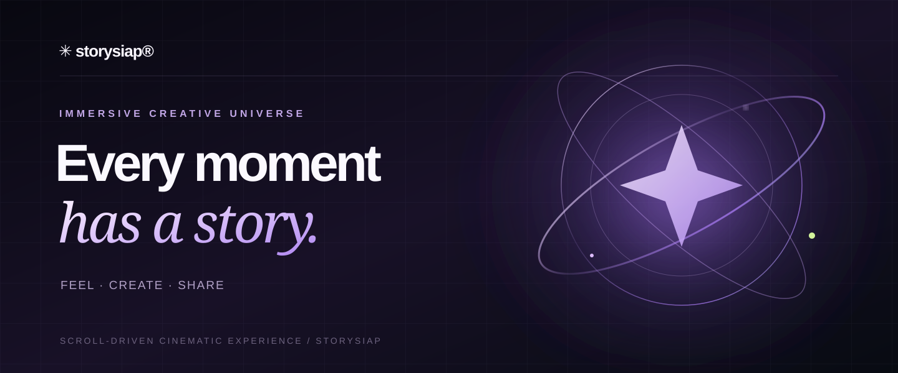
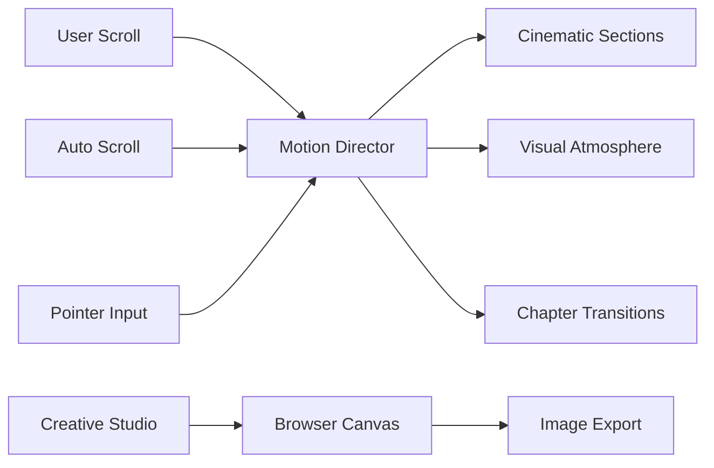

<div align="center">



<br /><br />

### ✦ Every moment has a story.

**A scroll-driven cinematic experience & a creative space for the moments worth keeping.**

[](https://wawanwfs.github.io/siapstory/)
[](https://wawanwfs.github.io/siapstory/studio.html)

[](https://github.com/wawanwfs/siapstory/actions/workflows/deploy-pages.yml)


<sub>FEEL THE MOMENT · FOLLOW THE MOTION · MAKE IT YOURS</sub>

</div>

---


## 🌐 LIVE WEBSITE / AKSES LANGSUNG

<div align="center">

### ✳ StorySiap sekarang bisa direview online

| 🚀 Halaman | URL akses |
| :-- | :-- |
| **Immersive Landing Page** | **https://wawanwfs.github.io/siapstory/** |
| **Creative Studio** | **https://wawanwfs.github.io/siapstory/studio.html** |
| **Source Code** | **https://github.com/wawanwfs/siapstory** |
| **Deployment Status** | **https://github.com/wawanwfs/siapstory/actions/workflows/deploy-pages.yml** |

**[▶ OPEN LIVE EXPERIENCE](https://wawanwfs.github.io/siapstory/) · [✳ OPEN CREATIVE STUDIO](https://wawanwfs.github.io/siapstory/studio.html)**

<sub>GitHub Pages · Automatic deployment from the \`main\` branch · URL tidak berubah saat source diperbarui.</sub>

</div>

## ✳ 01 / Beyond the ordinary landing page

**StorySiap** dirancang sebagai pengalaman kreatif yang bergerak bersama pengunjung, dengan arah visual dark cinematic, aksen violet, kedalaman 3D, dan interaksi yang berhubungan dengan posisi scroll.

> A little moment. A whole universe.

<table>
<tr><td width="50%" valign="top">

### ◉ The Experience
- Ambient lighting and floating visual layers
- Scroll-linked chapter progression
- Perspective and interactive depth effects
- Pointer-responsive motion
- Cinematic storytelling and responsive composition

</td><td width="50%" valign="top">

### ✦ In Your Control
- Auto-scroll Play / Pause
- Continuous and chapter-based playback
- Adjustable scroll pacing
- Navigation across the story
- Motion controls and reduced-motion support

</td></tr>
</table>

## ◇ 02 / Creative Studio

**Your image, your atmosphere, your story.**

Open the [Creative Studio](https://wawanwfs.github.io/siapstory/studio.html) to upload an image and give it your own look.

| Tool | Purpose |
| --- | --- |
| **Composition** | Story / feed / square / landscape framing |
| **Color** | Brightness, contrast, saturation, and cinematic presets |
| **Finishing** | Warmth, film grain, and vignette |
| **Live preview** | Inspect the result directly in the browser |
| **Export** | Save edited photos as PNG, or export trimmed videos with effects and optional original audio |
| **Timeline** | Set clip start, duration (up to 60 seconds), play/pause and scrub |
| **Format** | Auto / MP4 / WebM, selected only if the browser supports recording in that format |

**Local first.** Photo processing takes place in your own browser. Video trim, live color adjustments, original-audio routing, and **real video export** are now available through browser-native recording. Export selects MP4 or WebM according to the browser's encoder capabilities; **MP4 does not automatically guarantee H.264/AAC compatibility** with every social-media app. For maximum compatibility, use a supported browser and test the resulting clip before posting.

---

## ⌁ 03 / Architecture



The published website lives in `dist/` and is deployed as a static site. GitHub Actions keeps the public site updated when its deployment workflow succeeds.

### Video export · Browser compatibility

1. Open [Creative Studio](https://wawanwfs.github.io/siapstory/studio.html) and upload a supported video (MP4/H.264 recommended).
2. Choose a 9:16 canvas, output resolution, trim start and duration.
3. Adjust color and text, enable/disable original audio, and choose **Auto** for the container format.
4. Click **Export edited video**, keep the tab visible, then download and check the result.

**Compatibility notes:** Video export uses `canvas.captureStream()` and `MediaRecorder`. Not all browsers support the same encoders; WebM may be produced instead of MP4. Some browsers can generate MP4 with codecs unsupported by WhatsApp/Instagram. MOV/HEVC files may need conversion before editing. Recording works in real time and cannot prevent compression applied by social apps after uploading.

### Local preview

```bash
git clone https://github.com/wawanwfs/siapstory.git
cd siapstory
python -m http.server 8000 --directory dist
```

Navigate to `http://localhost:8000/`. Or open `dist/index.html` directly when your browser permits standalone HTML assets.

### Deployment

The `.github/workflows/deploy-pages.yml` workflow validates the published HTML, uploads the `dist/` folder, and deploys it to GitHub Pages.

- [Website](https://wawanwfs.github.io/siapstory/)
- [Creative Studio](https://wawanwfs.github.io/siapstory/studio.html)
- [Deployment workflow](https://github.com/wawanwfs/siapstory/actions/workflows/deploy-pages.yml)
- [Repository settings](https://github.com/wawanwfs/siapstory/settings/pages)

---

<div align="center">

### ✳ Make every moment a story.

**Designed to feel alive. Built to make memories.**

<sub>© 2026 StorySiap® · Crafted with motion, made for memories.</sub>

</div>
