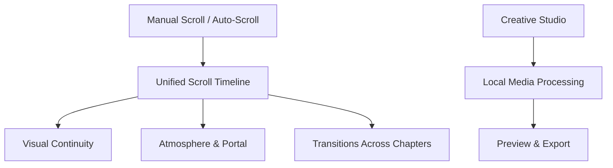

<div align="center">

# ✳ storysiap®

### EVERY MOMENT HAS A STORY

**The immersive creative studio, built for the feeling.**

[](https://wawanwfs.github.io/siapstory/)
[](https://wawanwfs.github.io/siapstory/studio.html)
[](https://github.com/wawanwfs/siapstory/actions/workflows/deploy-pages.yml)

**SCROLL · FEEL · CREATE · REMEMBER**

</div>

---

## 01 / The experience

StorySiap adalah pengalaman landing page sinematik dengan animasi yang mengikuti posisi scroll. Dibangun sebagai kreativitas visual untuk mempersiapkan foto dan video story, dengan kendali interaksi serta Studio pemrosesan lokal.

> **Momen kecil. Cerita besar.** Satu alur visual dari pembuka ke akhir — bukan sekadar animasi reveal terpisah.

## 02 / Cinematic interactions

| Chapter | Experience |
| --- | --- |
| ✦ One scroll timeline | Atmosfer, gerak lapisan, dan transisi mengikuti satu progres scroll. |
| ◉ Immersive portal | Cerita sinematik tiga adegan: Feel → Create → Share. |
| ↕ Auto-scroll | ON/OFF di kanan bawah, tiga kecepatan, mode alir atau mode bab. |
| ✳ Living atmosphere | Orbits, depth, 3D perspective, pointer-reactive movement. |
| ◐ Before / after | Kontrol perbandingan warna interaktif. |
| ◇ Responsive | Komposisi responsif untuk desktop dan mobile. |
| ♿ Reduced motion | Motion OFF serta preferensi aksesibilitas sistem. |

## 03 / Creative Studio

Creative Studio memungkinkan upload foto lalu penyesuaian rasio, brightness, contrast, saturation, warmth, grain dan vignette, dengan ekspor PNG langsung dalam browser. Video bisa dipreview, tetapi **ekspor video belum tersedia pada editor ringan yang saat ini diterbitkan**.

**Privacy first:** media diproses secara lokal di browser; tidak dikirim ke server StorySiap.

## 04 / How it works



### Run locally

Open `dist/index.html` in a compatible browser. For local server:

```bash
python -m http.server 8000 --directory dist
```

Then visit http://localhost:8000/ .

### Deploy

The workflow `.github/workflows/deploy-pages.yml` deploys the `dist/` directory on every push to `main`.

**One-time setup:** go to **Settings → Pages → Build and deployment → Source → GitHub Actions**. Run the workflow from **Actions → Publish StorySiap** if necessary.

Website: **https://wawanwfs.github.io/siapstory/**

---

<div align="center">

### ✳ A little moment. A whole universe.

*Made to move. Made to remember.*

**© 2026 storysiap®**

</div>